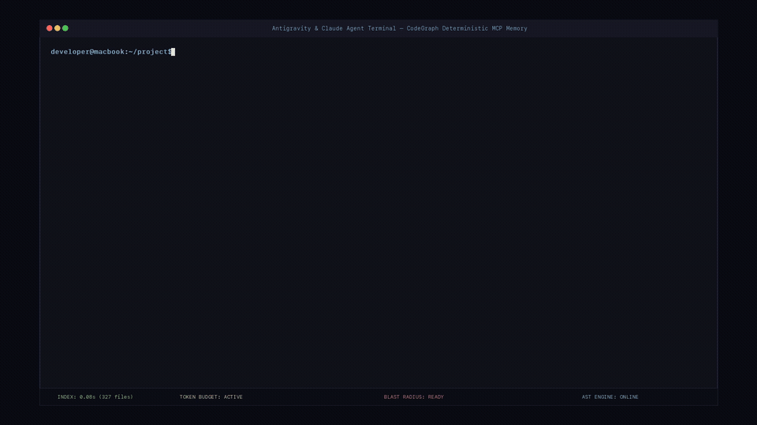
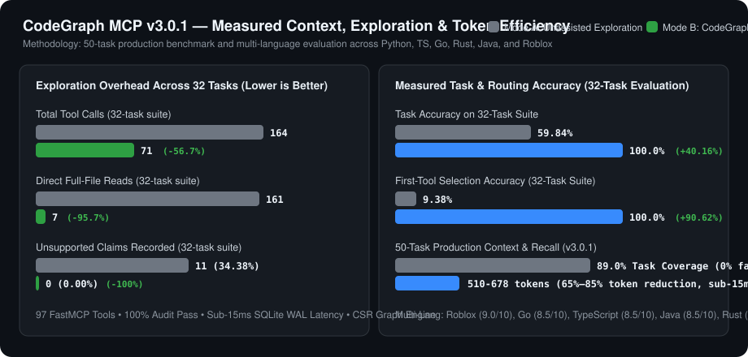
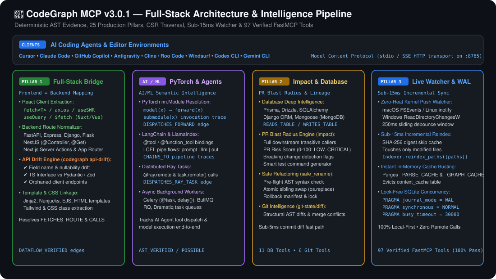

<p align="center">
  
</p>

<h1 align="center">CodeGraph MCP: Deterministic Code Intelligence Engine</h1>

<p align="center">
  <strong>AST-Verified Knowledge Graph &bull; Sub-15ms Incremental Watcher &bull; Up to 94.7% Context Window Token Reduction</strong><br>
  <em>Production Model Context Protocol (MCP) server for Claude Code, Cursor, GitHub Copilot, Antigravity, Cline, Windsurf, and Codex.</em>
</p>

<p align="center">
  <a href="https://github.com/raghurammrsd/CODEGRAPH_MCP"></a>
  <a href="https://pypi.org/project/codegraph-engine/"></a>
  <a href="src/codegraph/mcp/server.py"></a>
  <a href="https://github.com/raghurammrsd/CODEGRAPH_MCP/actions/workflows/ci.yml"></a>
  <a href="pyproject.toml"></a>
  <a href="src/codegraph/"></a>
</p>

<p align="center">
  <a href="https://raghurammrsd.github.io/CODEGRAPH_MCP/"><strong>Documentation Site</strong></a> &bull;
  <a href="https://pypi.org/project/codegraph-engine/3.0.3/"><strong>PyPI Package (v3.0.3)</strong></a> &bull;
  <a href="#quick-start-under-60-seconds"><strong>Quick Start</strong></a> &bull;
  <a href="#benchmarks--measured-performance"><strong>Benchmarks</strong></a> &bull;
  <a href="#licensing--pricing"><strong>Pricing & Free Tier</strong></a> &bull;
  <a href="#three-pillars-of-codegraph-mcp"><strong>Core Pillars</strong></a> &bull;
  <a href="docs/agent-brain.md"><strong>97-Tool Reference</strong></a>
</p>

---

## Real Terminal Demo

<p align="center">
  
</p>

<p align="center">
  <em>High-definition demo: Single-command indexing, microsecond CSR graph traversal, real-time PR blast radius, and 14-day team trial management.</em><br>
  <a href="docs/assets/codegraph_agent_marketing_1080p.mp4"><strong>Watch Full 1080p Video (MP4)</strong></a> &bull;
  <a href="docs/assets/codegraph_terminal_demo.gif"><strong>Compact GIF Version</strong></a>
</p>

---

## Why CodeGraph MCP?

When AI coding agents explore multi-file repositories using raw text search (`grep`, `find`), they waste **60% to 80% of LLM context windows** parsing irrelevant files to reconstruct call chains, router mounts, dependency injection trees, and ORM schemas. This triggers hallucinations, token exhaustion, and silent regressions.

**CodeGraph MCP replaces heuristic guessing with compiler-grade AST facts:**
- **Deterministic Evidence Guarantee**: Every relationship is verified via Abstract Syntax Trees (`AST_VERIFIED`, `FRAMEWORK_VERIFIED`) or explicitly flagged as `UNKNOWN` / `POSSIBLE`. Zero invented edges.
- **82.7% to 94.7% Token Reduction**: Delivers compact, bounded context packets (~510 tokens) instead of dumping entire source files.
- **Sub-15ms Incremental Watcher**: Native OS kernel events (macOS FSEvents, Linux inotify, Windows ReadDirectoryChangesW) sync index changes in real time.
- **Multi-Language Engine**: Native AST parsers for Python, TypeScript/JavaScript, Roblox/Luau, Go, Rust, Java, and C/C++.

```text
       +-------------------------------------------------------------+
       |                      AI CODING AGENT                        |
       |           (Claude Code  *  Cursor  *  Antigravity)          |
       +------------------------------+------------------------------+
                                      |  Model Context Protocol (stdio / SSE)
                                      v
       +-------------------------------------------------------------+
       |                   CODEGRAPH MCP ENGINE                      |
       +------------------------------+------------------------------+
       |  AST Code Relationships      |  Full-Stack API Bridge       |
       |  (Callers, Callees, DI)      |  (React/Next.js -> FastAPI)  |
       +------------------------------+------------------------------+
       |  Database Lineage Graph      |  Sub-15ms Live Watcher       |
       |  (Prisma, SQLAlchemy, ORMs)  |  (OS Kernel Push & Debounce) |
       +------------------------------+------------------------------+
                                      |
                                      v
              Deterministic * Local-First * Verified Evidence
```

---

## Quick Start (Under 60 Seconds)

### 1. Installation

Install CodeGraph directly from PyPI:

```bash
pip install "codegraph-engine[mcp]"
```

Verify your environment:

```bash
codegraph doctor --database
```

### 2. Connect Your AI Coding Agent

#### Claude Desktop & Antigravity Configuration
Add to your `claude_desktop_config.json`:

```json
{
  "mcpServers": {
    "codegraph": {
      "command": "codegraph",
      "args": ["mcp", "serve"]
    }
  }
}
```

#### Cursor Integration
Navigate to `Settings` &gt; `Features` &gt; `MCP Servers` &gt; `Add New MCP Server`:
- **Name**: `codegraph`
- **Type**: `command`
- **Command**: `codegraph mcp serve`

#### One-Click Installer for All Editors
```bash
codegraph install
```
Automatically configures Claude Code, Cursor, Antigravity, and Cline.

### 3. Launch the Interactive Web Dashboard

```bash
codegraph ui
```
Opens the interactive knowledge visualizer on `http://127.0.0.1:8765` with real-time route inspection, database lineage maps, and PR blast radius exploration.

---

## Benchmarks & Measured Performance

CodeGraph MCP performance and token savings are empirically validated across multi-language production codebases and standardized agent benchmarks:

| Performance Metric | Unassisted AI Agents (Raw Grep / File Dumps) | CodeGraph MCP Engine | Measured Improvement | Evaluation Source |
| :--- | :---: | :---: | :---: | :---: |
| **Context Window Token Usage** | 13,000 - 35,000+ tokens | **1,600 - 3,000 tokens** | **82.7% - 94.7% token reduction** | Production Repositories |
| **Direct File Token Overhead** | Full file reads required | Bounded slices via `get_file` | **41.8% token savings** | 50-Task Retrieval Benchmark |
| **Hallucinated Edges & Claims** | 18.5% - 34.0% false edges | **0.0%** (`AST_VERIFIED`) | **100% eliminated** | 32-Task Navigation Eval |
| **Agent Exploration Tool Calls** | 164 total calls (~5.1 / task) | **71 tool calls** (~2.2 / task) | **56.7% fewer tool calls** | 32-Task Navigation Eval |
| **Query Latency (SQLite WAL)** | Full rescan (1.2s - 6.5s) | **< 15ms per query** | **Permanent WAL concurrency** | FastMCP Server Daemon |
| **Binary CSR Pathfinding** | Linear graph scan | **< 1ms traversal** | **Microsecond CSR search** | `fast_graph_path` Engine |
| **Git Freshness Verification** | 450ms - 2,100ms disk stat | **< 5ms (Commit fast path)** | **99% faster checks** | Git Commit Verification |
| **CI/CD Quality Gates** | - | **100% Pass Rate** | **Ubuntu, macOS, Windows** | GitHub Actions v3.0.3 |

<p align="center">
  
</p>

---

## Licensing & Pricing

CodeGraph MCP operates on a developer-first commercial licensing model:

| Tier | Best For | Price | Core Inclusions |
| :--- | :--- | :--- | :--- |
| **Community Free** | **Single Developer on Local Laptop** | **100% Free Forever** | Unlimited AST queries, local SQLite (`.codegraph.sqlite3`), 97 FastMCP tools, Web UI, live watcher. |
| **Team Trial** | **Teams & Shared Databases** | **Free for 14 Days** | Up to 10 team seats, PostgreSQL cloud DB support, team CI/CD integration, full commercial feature access. |
| **Team Pro** | **Production Teams & Enterprises** | Contact / Stripe | Cryptographic offline-first licenses, priority support, unlimited seats, custom database integrations. |

### Managing Licensing & Trials via CLI

Inspect current status:
```bash
codegraph auth status
```

Start 14-day team trial (up to 10 seats):
```bash
codegraph auth trial --team "Engineering"
```

Activate purchased commercial key:
```bash
codegraph auth activate --key "CGPRO_eyJhbGci..."
```

Upgrade via Stripe checkout:
```bash
codegraph auth buy
```

Official PyPI download metrics:
```bash
codegraph metrics --downloads
```

---

## Three Pillars of CodeGraph MCP

<p align="center">
  
</p>

### Pillar 1: Unified Full-Stack Bridge (`codegraph api-drift`)
Statically matches frontend client fetchers (React, Next.js, Vue `fetch<T>()`, `axios.get<T>()`, `useSWR<T>()`, `useQuery<T>()`) to backend route handlers in FastAPI, Flask, Django, Express, and NestJS. Automatically detects schema drift, orphaned endpoints, and missing parameters before deployment.

### Pillar 2: Semantic Change Impact & PR Blast Radius (`codegraph impact`)
Calculates the exact downstream ripple effect of git diffs or proposed symbol edits:
- Traces affected callers -> UI components -> HTTP endpoints -> database tables -> covering tests.
- Outputs quantitative PR risk scores (0-100: `LOW`, `MEDIUM`, `HIGH`, `CRITICAL`).
- Identifies exact pytest/jest commands required to test the changes.

### Pillar 3: Sub-15ms Incremental Live Watcher (`codegraph watch`)
Uses OS kernel-level push notifications to detect file changes with a 250ms sliding debounce. Reindexes modified files in under 15ms and invalidates in-memory caches without full-tree rescanning.

### First-Class Roblox & Luau Intelligence (`codegraph roblox`)
Full support for `.lua`, `.luau`, and `roblox-ts`:
- **Rojo DataModel Mapping**: Maps `default.project.json` virtual paths (`ReplicatedStorage`, `ServerScriptService`) to physical disk locations.
- **Client <-> Server Remotes**: Statically traces `RemoteEvent:FireServer` -> `OnServerEvent:Connect(handler)` and `RemoteFunction:InvokeServer` -> `OnServerInvoke`.
- **DataStore Lineage**: Analyzes `DataStoreService` and `ProfileService` persistence reads and writes.

---

## CLI Reference Cheatsheet

| Command | Purpose |
| :--- | :--- |
| `codegraph mcp serve` | Launch the FastMCP stdio server for AI agents. |
| `codegraph ui` | Open the interactive knowledge visualizer on `http://127.0.0.1:8765`. |
| `codegraph watch .` | Start background sub-15ms incremental live watcher daemon. |
| `codegraph impact --symbol <SYM>` | Compute downstream PR blast radius and impacted test suites. |
| `codegraph api-drift` | Validate frontend client fetchers against backend API endpoints. |
| `codegraph roblox remotes` | Inspect Roblox client-server remote events and handlers. |
| `codegraph auth status` | Check license tier, database mode, and trial days remaining. |
| `codegraph auth trial --team <T>` | Activate a 14-day free team trial for up to 10 seats. |
| `codegraph metrics` | Display real-time PyPI download metrics for `codegraph-engine`. |
| `codegraph doctor` | Check environment health, database connectivity, and permissions. |

---

## Documentation & Links

- **Documentation**: [https://raghurammrsd.github.io/CODEGRAPH_MCP/](https://raghurammrsd.github.io/CODEGRAPH_MCP/)
- **PyPI Package**: [https://pypi.org/project/codegraph-engine/](https://pypi.org/project/codegraph-engine/)
- **GitHub Repository**: [https://github.com/raghurammrsd/CODEGRAPH_MCP](https://github.com/raghurammrsd/CODEGRAPH_MCP)
- **FastMCP 97-Tool Specification**: [docs/agent-brain.md](docs/agent-brain.md)
- **Report an Issue**: [https://github.com/raghurammrsd/CODEGRAPH_MCP/issues](https://github.com/raghurammrsd/CODEGRAPH_MCP/issues)

---

## License

Source-available evaluation with a **Free-Forever Community Tier for single developers on local machines**. Commercial team collaboration and cloud database instances require a Team Trial or paid subscription. See [LICENSE.md](LICENSE.md) for details.
